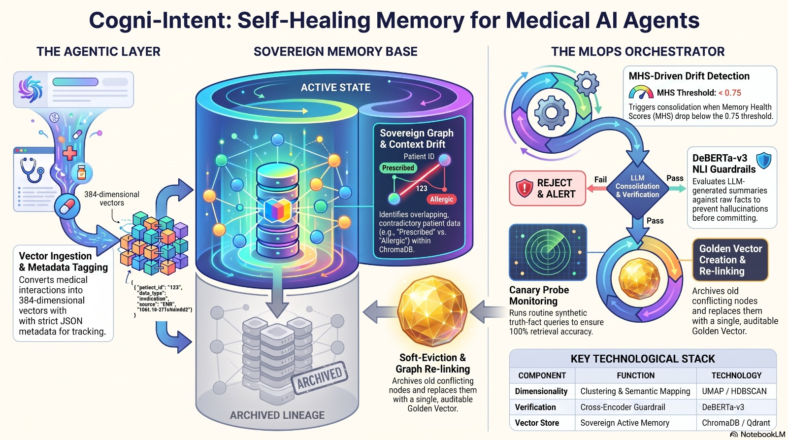
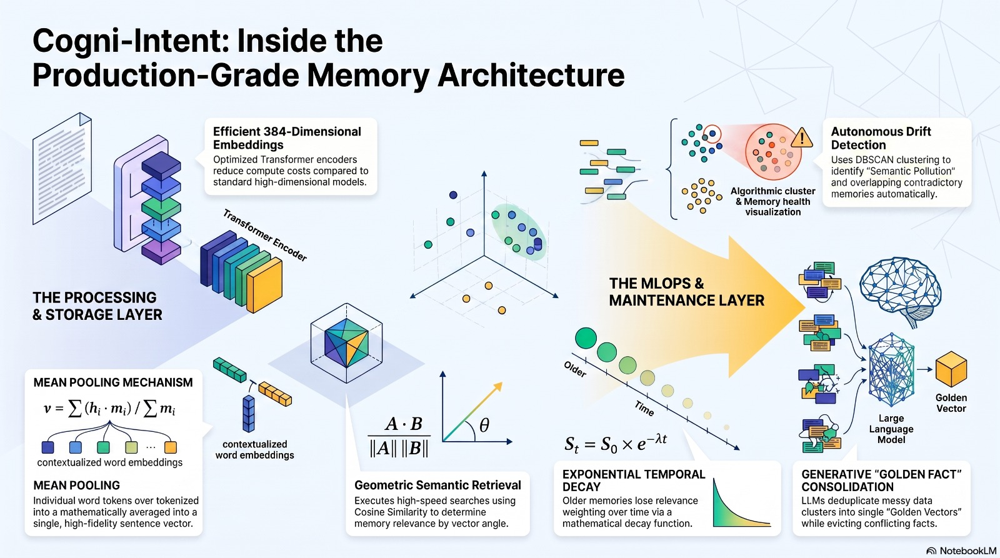

<div align="center">

# 🧠 Cogni-Intent
### Autonomous Self-Healing Vector Memory & Drift Mitigation Immune System for AI Agents

[](https://tannishtha3183.github.io/cogni-intent/index.html)
[](https://github.com/Tannishtha3183/cogni-intent/actions)
[](https://www.python.org/)
[](https://fastapi.tiangolo.com/)
[](https://www.trychroma.com/)
[](LICENSE)

<br/>

> **Cogni-Intent** is an autonomous MLOps platform and vector memory immune system designed to prevent catastrophic memory confusion in long-running AI agents. It continuously scans vector embedding spaces, clusters chronologically contradictory statements, synthesizes consolidated **Golden Facts** using LLMs, and executes diachronic soft-eviction with zero audit data loss.

<br/>

### 🌟 [👉 Click Here to Launch the Live Interactive Platform 👈](https://tannishtha3183.github.io/cogni-intent/index.html)

**[🚀 Live Simulation Lab](https://tannishtha3183.github.io/cogni-intent/simulation.html)** &bull;
**[📘 Interactive User Manual](https://tannishtha3183.github.io/cogni-intent/manual.html)** &bull;
**[📖 System Architecture](https://tannishtha3183.github.io/cogni-intent/architecture.html)** &bull;
**[⚙️ MLOps Workflow](https://tannishtha3183.github.io/cogni-intent/workflow.html)** &bull;
**[🔄 Memory Lifecycle](https://tannishtha3183.github.io/cogni-intent/lifecycle.html)** &bull;
**[🛡️ Recovery Logic](https://tannishtha3183.github.io/cogni-intent/recovery.html)** &bull;
**[⚠️ Limitations & Roadmap](https://tannishtha3183.github.io/cogni-intent/limitations.html)**

<br/>



</div>

---

## 📑 Table of Contents

- [The Core Problem: Why Traditional Vector Memory Fails](#-the-core-problem-why-traditional-vector-memory-fails)
- [How Cogni-Intent Solves It: Before vs. After Healing](#-how-cogni-intent-solves-it-before-vs-after-healing)
- [System Architecture & 4-Pillar Pipeline](#-system-architecture--4-pillar-pipeline)
  - [1. Dense Semantic Ingestion](#1-dense-semantic-ingestion)
  - [2. Unsupervised Collision & Drift Detection](#2-unsupervised-collision--drift-detection)
  - [3. Surgical LLM Consolidation (Golden Facts)](#3-surgical-llm-consolidation-golden-facts)
  - [4. Diachronic Soft-Eviction & Lineage Tracking](#4-diachronic-soft-eviction--lineage-tracking)
- [Live Interactive Web Suite Tour](#-live-interactive-web-suite-tour)
- [Quickstart: Local Backend Setup](#-quickstart-local-backend-setup)
- [Docker Deployment](#-docker-deployment)
- [Automated Test Suite & CI/CD Pipeline](#-automated-test-suite--cicd-pipeline)
- [Repository Structure](#-repository-structure)
- [Project Documentation & Presentations](#-project-documentation--presentations)
- [License & Citation](#-license--citation)

---

## 🚨 The Core Problem: Why Traditional Vector Memory Fails

Traditional Retrieval-Augmented Generation (RAG) and semantic vector databases (e.g., ChromaDB, Pinecone, FAISS) retrieve context strictly by **cosine similarity** or Euclidean distance in embedding space. They are completely oblivious to **chronological invalidations**, clinical medication updates, and temporal shifts.

When an autonomous AI agent (such as a medical assistant or legal advisor) operates continuously over months or years, contradictory facts accumulate in the same cluster:

```
Timeline:
Day 01  ──►  "Patient prescribed Albuterol inhaler for mild asthma symptoms."
Day 16  ──►  "Asthma worsened. Discontinue Albuterol, escalate to Symbicort."
Day 40  ──►  "Severe heart palpitations! Discontinue Symbicort immediately. Prescribe Flovent."
```

### ❌ What happens without Cogni-Intent:
When a physician asks *"What inhaler should I prescribe for this patient's asthma?"*, naive semantic search calculates high cosine similarity with **all three notes** because they all describe `asthma`, `patient`, and `inhaler`. The AI agent hallucinates, mixes discontinued drugs with active ones, and recommends a lethal, contraindicated medication.

### ✅ What happens with Cogni-Intent:
Cogni-Intent's autonomous background daemon continuously measures **Memory Health Score (MHS)**. When semantic drift breaches tolerance ($\text{MHS} < 0.75$), the immune system:
1. Detects and isolates the colliding clinical records.
2. Synthesizes an authoritative **Golden Fact** (*"Patient has asthma, intolerant to Albuterol and Symbicort (severe palpitations); currently prescribed Flovent"*).
3. Soft-evicts obsolete memories (`is_archived = true`) so the agent never retrieves them in active inference.
4. Preserves full historical lineage in a **Directed Acyclic Graph (DAG)** for medical and legal compliance.

---

## ⚖️ How Cogni-Intent Solves It: Before vs. After Healing

| Feature | ❌ Standard RAG / Traditional Vector DB | ✅ Cogni-Intent Self-Healing Memory System |
| :--- | :--- | :--- |
| **Retrieval Metric** | Pure Cosine Similarity (blind to time) | Time-Aware Diachronic Filtering (`is_archived: false`) |
| **Handling Contradictions** | Retrieves both old and new facts; hallucination risk | Automated cross-encoder NLI conflict clustering |
| **Resolution Strategy** | None (LLM prompt must resolve conflict) | Proactive background LLM surgery creating **Golden Facts** |
| **Data Preservation** | Hard deletion causes legal/audit trail loss | **Zero data loss**: historical records preserved in audit DAG |
| **Health Monitoring** | None (silent failure) | Real-time **Memory Health Score (MHS)** metric & alerts |
| **Deployment Mode** | Requires heavy cloud infrastructure | **Dual-Engine**: 100% static in-browser demo + full FastAPI backend |

---

## 🏗️ System Architecture & 4-Pillar Pipeline


<div align="center">
  
</div>

### 1. Dense Semantic Ingestion
- Leverages `all-MiniLM-L6-v2` (PyTorch Sentence-Transformers) producing normalized **384-dimensional vectors**.
- Reduces vector memory footprint by **75%** compared to OpenAI 1536-D embeddings without sacrificing clinical semantic nuance.
- Every record is enriched with strict MLOps schema: `patient_id`, `timestamp`, `is_archived`, `is_consolidated`, and `supersedes_ids`.

### 2. Unsupervised Collision & Drift Detection
- Projects high-dimensional embedding spaces into 2D manifolds via **UMAP** (*Uniform Manifold Approximation and Projection*).
- Uses **HDBSCAN** to group high-density semantic collisions in $O(N \log N)$ complexity.
- Validates semantic divergence using Natural Language Inference (NLI) to differentiate between legitimate supplementary facts and hazardous clinical contradictions.

### 3. Surgical LLM Consolidation (Golden Facts)
- Clusters flagged with critical drift are passed to the **Cognitive Healer**.
- Powered by **Gemini 2.0 Flash** (or a local deterministic NLP fallback when offline).
- Resolves conflicting medication timelines, dose changes, and contraindications into a single verified **Golden Fact**.

### 4. Diachronic Soft-Eviction & Lineage Tracking
- Outdated notes are marked `is_archived = True` and removed from the active context pool.
- Records are **never hard-deleted**, ensuring 100% medical auditability (HIPAA/FDA compliance).
- Lineage links (`supersedes_ids`) form an interactive Directed Acyclic Graph (DAG) demonstrating evolutionary memory progression.

---

## 🌐 Live Interactive Web Suite Tour

The repository includes a complete, interactive 8-page client-side simulation suite hosted on GitHub Pages:

| Page | URL | Description |
| :--- | :--- | :--- |
| **🏠 Main Portal** | [index.html](https://tannishtha3183.github.io/cogni-intent/index.html) | Executive platform overview, health score gauges, and feature showcase. |
| **🧪 Simulation Lab** | [simulation.html](https://tannishtha3183.github.io/cogni-intent/simulation.html) | Interactive 2D UMAP scatterplot, doctor AI chat sandbox (before vs. after healing), and live healing triggers. |
| **📘 User Manual** | [manual.html](https://tannishtha3183.github.io/cogni-intent/manual.html) | 60-second crash course, 5-step lab walkthrough, and comprehensive FAQ. |
| **🏛️ Architecture** | [architecture.html](https://tannishtha3183.github.io/cogni-intent/architecture.html) | Vector space geometry, embedding specifications, and mathematical formulations. |
| **⚙️ Workflow** | [workflow.html](https://tannishtha3183.github.io/cogni-intent/workflow.html) | End-to-end MLOps pipeline lifecycle from streaming ingestion to soft-eviction. |
| **🔄 Lifecycle** | [lifecycle.html](https://tannishtha3183.github.io/cogni-intent/lifecycle.html) | Long-term memory state machine and diachronic schema evolution. |
| **🛡️ Recovery Logic** | [recovery.html](https://tannishtha3183.github.io/cogni-intent/recovery.html) | Fail-safe mechanisms, audit trails, and deterministic fallback procedures. |
| **⚠️ Limitations** | [limitations.html](https://tannishtha3183.github.io/cogni-intent/limitations.html) | Edge cases, computational complexity trade-offs, and engineering roadmap. |

---

## 💻 Quickstart: Local Backend Setup

To run the complete Python backend locally with **FastAPI**, **ChromaDB**, and **PyTorch**:

### 1. Prerequisites
- Python 3.10 or 3.11
- Git

### 2. Clone and Setup Environment
```bash
# Clone the repository
git clone https://github.com/Tannishtha3183/cogni-intent.git
cd cogni-intent

# Create and activate virtual environment
python -m venv venv

# Windows PowerShell:
.\venv\Scripts\Activate.ps1

# Linux / macOS:
source venv/bin/activate
```

### 3. Install Dependencies
```bash
# Upgrade pip
python -m pip install --upgrade pip

# Install package in development mode
pip install .[dev]
```

### 4. Configure Environment Variables (Optional)
```bash
# Windows PowerShell:
$env:GEMINI_API_KEY="your_google_gemini_api_key"

# Linux / macOS:
export GEMINI_API_KEY="your_google_gemini_api_key"
```
*(If no API key is provided, the system seamlessly operates using its built-in deterministic local NLP healer.)*

### 5. Launch the FastAPI MLOps Daemon
```bash
python src/api/main.py
```

- **Interactive Web App**: [http://localhost:8080](http://localhost:8080)
- **FastAPI OpenAPI Swagger**: [http://localhost:8080/docs](http://localhost:8080/docs)
- **Health Check Endpoint**: [http://localhost:8080/api/health](http://localhost:8080/api/health)

---

## 🐳 Docker Deployment

Run the complete platform via Docker and Docker Compose with one command:

```bash
docker-compose up --build
```

Access the service at `http://localhost:8080`.

---

## 🧪 Automated Test Suite & CI/CD Pipeline

Cogni-Intent includes an automated test and verification suite enforced on every push via **GitHub Actions CI**:

```bash
# Run pytest unit tests (Storage, soft-eviction, queries)
pytest tests/

# Run the complete end-to-end backend verification suite
python tests/run_tests.py

# Run static quality & DOM integrity audit
python tests/deep_audit.py
python tests/verify_pages.py

# Lint codebase with Ruff
ruff check .
```

### CI/CD Workflow Highlights
- **Fast CPU Caching**: Utilizes pre-compiled PyTorch CPU wheels (`whl/cpu`) and GitHub Actions pip caching for fast build times (~1.5 minutes).
- **Multi-Phase Verification**: Validates dependencies, checks strict lint standards, and executes test suites.

---

## 📁 Repository Structure

```
cogni-intent/
├── .github/
│   └── workflows/
│       ├── ci.yml               # GitHub Actions Automated CI Pipeline
│       └── pages.yml            # GitHub Pages Deployment Workflow
├── Report and PPT/
│   ├── Cogni-Intent_Final_Project_Presentation.pptx  # Final presentation slides
│   ├── Cogni-Intent_Project_Report (1).docx          # Full technical report (Word)
│   └── Cogni-Intent_Project_Report (1).pdf           # Full technical report (PDF)
├── assets/
│   └── images/                  # High-resolution architectural schematics
├── config/
│   └── pipeline_config.json     # MLOps drift thresholds and model parameters
├── data/
│   └── synthetic_logs.csv       # Clinical patient timelines & memory notes
├── src/
│   ├── api/
│   │   └── main.py              # FastAPI REST endpoints & simulation daemon
│   ├── core/
│   │   └── logger.py            # Unified structured logging utility
│   ├── ingestion/
│   │   ├── encoder.py           # 384-D SentenceTransformer dense encoder
│   │   └── pipeline.py          # Batch and streaming ingestion logic
│   ├── mlops/
│   │   ├── drift_detector.py    # UMAP + HDBSCAN + NLI contradiction detector
│   │   └── healer.py            # Gemini 2.0 Flash / NLP Golden Fact healer
│   └── storage/
│       └── vector_client.py     # Persistent ChromaDB client & diachronic DAG
├── tests/
│   ├── deep_audit.py            # Page DOM, JS IDs, and asset validator
│   ├── run_tests.py             # Full backend integration test runner
│   ├── test_storage.py          # Pytest suite for ChromaDB soft-eviction
│   └── verify_pages.py          # GitHub Pages link & asset integrity checker
├── architecture.html            # Vector space & schema architecture page
├── index.html                   # Main executive portal
├── lifecycle.html               # Memory lifecycle state machine page
├── limitations.html             # Known challenges & roadmap page
├── manual.html                  # User manual & guide
├── recovery.html                # Recovery & self-healing logic page
├── simulation.html              # Live simulation lab
├── workflow.html                # Total MLOps pipeline workflow page
├── pyproject.toml               # Python package config & Ruff linter rules
├── Dockerfile                   # Container definition
├── docker-compose.yml           # Multi-container orchestration
└── README.md                    # Project documentation
```

---

## 📚 Project Documentation & Presentations

Comprehensive project deliverables are included directly in the repository:

- 📄 **[Technical Project Report (PDF)](Report%20and%20PPT/Cogni-Intent_Project_Report%20(1).pdf)**: In-depth academic report covering background research, mathematical foundations, experimental results, and safety validations.
- 📄 **[Technical Project Report (Word)](Report%20and%20PPT/Cogni-Intent_Project_Report%20(1).docx)**: Formatted editable document.
- 📊 **[Final Presentation Deck (PPTX)](Report%20and%20PPT/Cogni-Intent_Final_Project_Presentation.pptx)**: Project slide deck designed for review panels and technical presentations.

---

## 📜 License & Citation

Distributed under the **MIT License**. See `LICENSE` for more information.

If you find Cogni-Intent helpful in your research or AI agent development, please consider starring the repository ⭐!

<div align="center">
  <sub>Built with ❤️ for resilient, contradiction-free AI agent memory.</sub>
</div>
