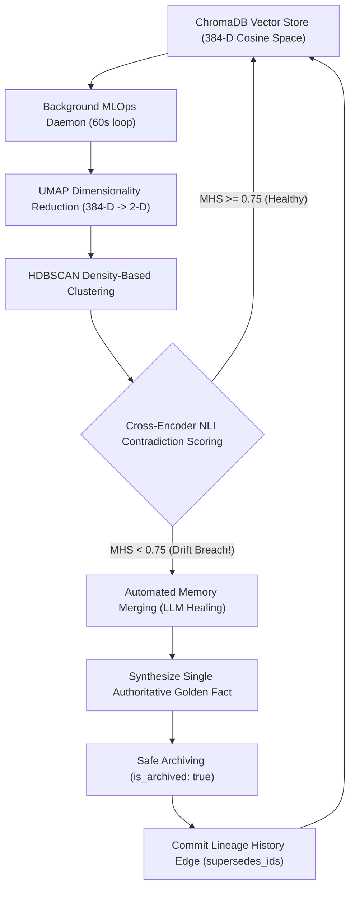

<div align="center">

# 🧠 Cogni-Intent
**Stopping Memory Confusion & Drift in Long-Term AI Agents**

[](https://www.python.org/)
[](https://fastapi.tiangolo.com/)
[](https://www.trychroma.com/)
[](https://pages.github.com/)
[](LICENSE)

*An autonomous MLOps platform & memory immune system that continuously detects contradictions in AI memory, automatically merges conflicting facts into authoritative Golden Facts, and safely archives older records with zero data loss.*

[**🚀 Launch Live Simulation Lab**](simulation.html) &bull; [**📘 Plain-English User Guide**](manual.html) &bull; [**📖 Architecture Specs**](architecture.html) &bull; [**⚙️ MLOps Workflow**](workflow.html)

</div>

---

## 📖 The Core Problem: Why Traditional Vector Memory Fails

When autonomous AI agents operate over months or years, their vector databases accumulate chronological updates. Traditional retrieval-augmented generation (RAG) retrieves solely by cosine distance, completely oblivious to chronological invalidations.

> **Clinical Example:**
> - **Day 1:** *"Patient prescribed Albuterol inhaler for mild asthma."*
> - **Day 16:** *"Escalated to Symbicort."*
> - **Day 40:** *"Severe heart palpitations! Discontinue Symbicort immediately, prescribe Flovent."*
>
> ❌ **Without Cogni-Intent:** Naive vector search retrieves **all three notes** because they all contain "asthma" and "inhaler". The AI agent gets confused and recommends the dangerous, discontinued drug!
>
> ✅ **With Cogni-Intent:** The background immune engine spots the contradiction, automatically merges the notes into a single clear **Golden Fact** (*"Asthma, intolerant to Symbicort/Albuterol; currently prescribed Flovent"*), and safely archives the older records in a visual history tree.

---

## 📘 Interactive User Manual & Guide ([manual.html](manual.html))

For evaluators, recruiters, and new users, a comprehensive, plain-English user manual is available at [manual.html](manual.html):

- **⚡ 60-Second Crash Course**: The Problem, The Solution, and The Result explained in simple, non-technical terms.
- **🧪 5-Step Simulation Lab Walkthrough**: Step-by-step instructions on choosing clinical scenarios, testing the doctor chat before healing, running the auto-healing immune loop, and inspecting the healed Golden Fact.
- **🗺️ Website Navigation Guide**: Interactive feature tour for every page (`index.html`, `simulation.html`, `architecture.html`, `workflow.html`, `recovery.html`, `lifecycle.html`, `limitations.html`).
- **❓ FAQ**: Answers regarding client-side vs. backend execution, Memory Health Score (MHS), and custom scenario injection.

## 🏗️ Technical Architecture & Pipeline



---

## ✨ Key Capabilities

1. **🧠 NLP Sentence-BERT Foundation**: Uses 384-D dense embeddings (`all-MiniLM-L6-v2`) with mean pooling, slashing memory footprint by 75% compared to 1536-D models while preserving clinical semantics.
2. **🔬 Unsupervised MLOps Drift Detection**: Couples **UMAP** 2D mapping with **HDBSCAN** density clustering to identify semantic collisions in $O(N \log N)$ runtime.
3. **🛡️ Cross-Encoder NLI Guardrails**: Eliminates false alarms by verifying semantic opposition (Entailment vs Contradiction) across memory pairs.
4. **🩺 Automated Memory Merging**: Uses LLMs (like Gemini) to reconcile conflicting statements into a single verified **Golden Fact**.
5. **🗄️ Safe Archiving History Tree**: Outdated notes are never deleted; history links preserve 100% of past clinical records for medical and legal compliance.
6. **🤖 Interactive Agent Doctor Chat Sandbox**: Test simulated queries **before healing** (observing confusion and warnings) and **after healing** (observing verified ground truth).
7. **🌐 Dual-Engine Deployment (GitHub Pages Ready)**: Runs directly in any web browser with a zero-dependency high-fidelity client engine, while seamlessly connecting to the live FastAPI + ChromaDB backend when running locally!

---

## 🌐 Deploying to GitHub Pages

Cogni-Intent is built with relative asset links and client-side NLP/MLOps fallbacks, making it **100% deployable to GitHub Pages with zero external server dependencies**:

1. Push this repository to GitHub:
   ```bash
   git add .
   git commit -m "feat: complete Cogni-Intent MLOps platform"
   git push origin main
   ```
2. Navigate to **Settings &rarr; Pages** on your GitHub repository.
3. Under **Build and deployment &rarr; Source**, select **Deploy from a branch**.
4. Set branch to `main` and folder to `/ (root)`.
5. Click **Save**. Your interactive Cogni-Intent platform is live at `https://<your-username>.github.io/<repo-name>/`!

---

## 💻 Local Setup (With FastAPI Backend & ChromaDB)

If you prefer to run the full Python backend locally:

```bash
# 1. Clone the repository
git clone https://github.com/<your-username>/cogni-intent.git
cd cogni-intent

# 2. Activate virtual environment or install dependencies
pip install -r requirements.txt

# 3. (Optional) Configure Gemini API Key for live LLM consolidation
export GEMINI_API_KEY="your_api_key_here"   # Linux/macOS
$env:GEMINI_API_KEY="your_api_key_here"      # Windows PowerShell

# 4. Start the FastAPI MLOps Daemon
python src/api/main.py
```

- **Interactive Web UI**: [http://localhost:8080](http://localhost:8080)
- **FastAPI Interactive Swagger Docs**: [http://localhost:8080/docs](http://localhost:8080/docs)
- **Live Health Endpoint**: [http://localhost:8080/api/health](http://localhost:8080/api/health)

---

## 🧪 Testing

Run the automated test suite verifying NLP encoding, ChromaDB soft-eviction, drift detection, and healer schemas:

```bash
python tests/run_tests.py
```

---

## 📜 License

Distributed under the MIT License. See `LICENSE` for details.
